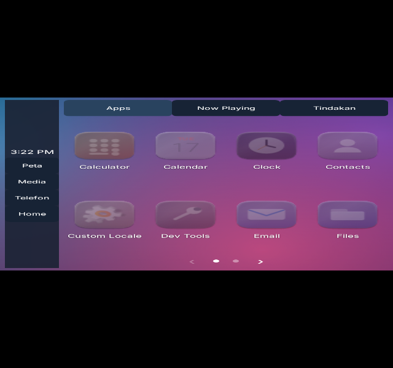
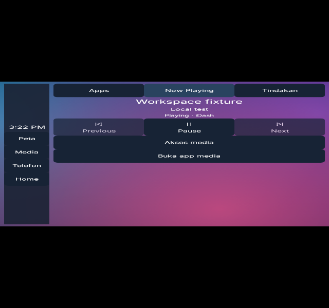

# Audit branch dan adaptasi template untuk iDash3 — 17 November 2026

## Sumber dan skop

Permintaan pengguna: semak main dan branch dahulu, adaptasi konsep template CarPlay kepada iDash3, teruskan penambahbaikan di branch versi lain, dan jangan ubah glass panel.

Rujukan pengguna: [Developing iOS Apps for Apple CarPlay](https://rajasoftwarelabs.com/blog/developing-ios-apps-for-apple-carplay), petikan tentang had tab/kedalaman/item dan screenshot Tab, Now Playing, List, Alert serta grid 4×2/rail kiri. Permintaan HTTP artikel dan PDF Apple yang dicuba dalam sesi ini membalas 403. Penilaian ini menggunakan petikan/screenshot yang pengguna beri serta source iDash3; ia tidak mendakwa mengesahkan semula peraturan Apple terkini.

iDash3 ialah launcher Android bebas pada head unit TEST9278B/MT8227L, Android 8.1/API27, ARM32, RAM 1 GB dan Mali-450. Tiada CarPlay framework, iPhone renderer, entitlement Apple atau projek iOS digunakan. Angka had yang dilaksanakan di bawah ialah pilihan produk iDash, bukan peraturan Apple yang dikenakan kepada Android.

## Audit main dan semua branch remote sebelum kerja

| Branch | Tip disemak | Kandungan / keputusan |
|---|---|---|
| main | a96888d | Baseline asal; bukan sasaran commit. Belum mempunyai pembetulan rc1/rc2. |
| claude/hopeful-cannon-r401pi | 943d508 | Ancestor main, 19 commit di belakang. Perbandingan tip menunjukkan beberapa pembetulan Drive/ikon dan dokumen audit belum ada; tiada commit unik untuk dibawa ke rc3. |
| audit/crash-lag-2026-11-17 | c44bd22 | Audit dan bukti prestasi; sumber aplikasi sama dengan baseline. |
| fix/crash-lag-no-glass | a42b470 | rc1: pengendalian kegagalan imej/ikon, worker rangkaian berasingan dan discovery Drive di latar. |
| fix/maps-panel-app-layout | 5ed2085 | rc2: App Library 4×2 dan custom fullscreen video dalam panel; asas rc3. |

Branch hasil: `feat/drive-templates-rc3`, versi `0.2.1-rc3`, versionCode 4. Tiada merge ke main dibuat. Snapshot remote di atas ialah pemerhatian semasa audit, bukan andaian bahawa branch lain tidak akan berubah kemudian.

## Jurang yang ditemui dan tindakan

| Bidang | Apa yang ada | Penambahbaikan rc3 |
|---|---|---|
| Grid | rc2 sudah 4×2, lapan app/halaman | Diguna semula dalam workspace; tidak membina salinan cache ikon. |
| Navigasi | Home, Apps, Settings dan setup Drive berasingan | Workspace pilihan dengan tiga tab tetap dan tiada push-stack dalaman. |
| Now Playing | MediaSession bridge hanya dipaparkan dalam Control Center | Template Now Playing tersendiri, menggunakan bridge yang sama tanpa mengubah Control Center. |
| Pintasan | Dock asal Bluetooth/Files/YouTube | Rail workspace untuk peta, media, telefon/Bluetooth dan Home; pilihan peta/media sedia ada dihormati. |
| List | Senarai app panjang/Settings pelbagai kategori | Template Tindakan dengan empat baris tetap dan tinggi 56 dp. |
| Alert | Dialog pelbagai fungsi sedia ada | Alert app tidak tersedia mempunyai dua tindakan: Tutup dan App Library; ditutup ketika pause. |
| Lifecycle | Callback media sedia ada dijeda melalui Control Center | Workspace menjeda bridge ketika tab ditukar/Activity dijeda dan menutupnya ketika navigasi/Activity dimusnahkan. |
| Glass panel | Dikunci oleh arahan pengguna | Kod material, dimensi panel Home/media, aset, tint, blur, border dan animasi kekal. |

## Cara guna dan had yang benar-benar dilaksanakan

Apps → **App Library · Ringkas ›** membuka workspace. Rail kiri mengandungi jam Android serta Peta, Media, Telefon dan Home. Peta/media menggunakan pilihan Drive yang masih dipasang; jika pilihan sudah tiada, senarai keutamaan sedia ada digunakan. Telefon cuba app Bluetooth OEM/dialer/contacts yang dipasang, tanpa membuat panggilan secara automatik.

Tiga tab ialah **Apps**, **Now Playing**, **Tindakan**. Setiap tab ialah root, jadi bertukar tab tidak menambah history stack. Dialog bantuan berada satu aras di atas root. Had lima template yang disebut dalam petikan tidak disalin secara membuta tuli: workspace baharu hanya memerlukan satu root serta satu dialog. Had ini tidak mengawal menu dalam app Waze/YouTube/Android Settings yang dibuka di luar iDash.

Now Playing memaparkan tajuk, artis, status, Previous/Play-Pause/Next mengikut action mask sesi sebenar. Kawalan tanpa sokongan atau tanpa akses dilumpuhkan. Tiada album artwork, WebView, video decoder, polling metadata atau akses kandungan notifikasi baharu ditambah. Akses media menggunakan permission Notification Listener sedia ada dan penerangan sedia ada; pengguna boleh menolak akses. iPhone tidak diperlukan untuk UI head unit ini, tetapi app luar masih mempunyai keperluan rangkaian/Bluetooth/akaun masing-masing.

Template Tindakan mempunyai empat baris: Buka peta, Buka media, Telefon/Bluetooth, Setup split-screen. Semua butang rail/tab/list sekurang-kurangnya 56 dp; transport media 72 dp. Butang workspace mempunyai fokus perkakasan/D-pad serta indikator fokus, tekan dan tab terpilih; touch tidak diperlukan untuk setiap tindakan. Grid tetap lapan item setiap halaman. Tiada search keyboard dalam workspace; carian penuh kekal di App Library asal. Back dan Home keluar ke Home iDash; tab terakhir disimpan dalam state Activity.

Workspace mempunyai rail/tab sendiri; header/dock Home tidak diduplikasi pada route ini. Kembali ke Home memaparkan semula layout Home asal tanpa mengubah pembinanya. Ini ialah workspace **pilihan**. Ia tidak menggantikan Home, menukar dock, mengubah panel kaca atau memaksa pilihan media/peta pengguna. Permukaan baharu ialah view Android biasa dengan warna solid; ia tidak menambah GlassSurface baharu. Tiada janji pensijilan CarPlay/Android Auto atau pengesahan keselamatan memandu dibuat. Tiada pengesanan kelajuan kenderaan atau sekatan automatik berdasarkan pergerakan dilaksanakan.

## Batas audit dan perkara seterusnya

- Google Maps yang stagnant semasa mencari tempat belum direproduksi pada unit fizikal. Workspace tidak membaiki kod/versi Google Maps atau mengubah pemasangan app pihak ketiga.
- Kebolehpercayaan split-screen, video decoder dan prestasi bersama Waze/YouTube pada Cortex-A7/Mali-450 masih memerlukan ujian head unit.
- Banjir bake kaca, polisi Auto dan cache trim kekal di luar skop kerana pengguna mengunci glass panel.
- Keutamaan seterusnya: uji hit target/kontras pada skrin kereta sebenar, sahkan pilihan app dan MediaSession OEM, bandingkan carian Maps/Waze secara standalone, dan ukur PSS/framestats. Jangan tambah chat, notification reader, mikrofon atau kawalan kenderaan tanpa skop dan akses yang sesuai.

## Pengesahan

Keputusan akhir: binaan debug lulus; 47 ujian unit lulus (0 gagal/errors/skips); lint 0 errors / 63 warnings. DrivingWorkspaceChecks 33, AppLibraryChecks 17, PanelFullscreenChecks 14 dan SmokeChecks 57 assertion lulus, semuanya dengan stream=PASS dan INSTRUMENTATION_CODE: -1 (jumlah 121 assertion). APK guard, signature dan checksum disahkan.

Bukti build dan runner yang benar-benar selesai disimpan dalam `audit-evidence/0.2.1-rc3/`. Ujian sesi media mencipta sesi Android tempatan, mengesahkan metadata/action mask dan Play/Pause, serta memulihkan Notification Listener Access kepada keadaan asal. Emulator API27 x86_64 menggunakan TCG/SwiftShader; angka masa/memorinya bukan benchmark head unit ARM32.

Pemeriksaan diff terhadap baseline rc2 meliputi Glass*, IosStyle, IconStyler, IosGlyphs, AppearanceEditor, Spring/SpringDriver, Elastic, MorphOverlay, Squircle, HomeGrid, DashWebPlayer, QuickControls, ControlMedia, DrivePage/Controller/BarService, res dan assets. Fail-fail tersebut tidak diubah. Dalam LauncherActivity, perubahan terhad kepada route/workspace lifecycle, pemulihan state tab dan entry Apps; method pembina panel/home sedia ada kekal.

Percubaan regresi panel pertama terhenti apabila initial app discovery membina semula Home semasa fixture video sementara masih dipasang terus di body. PanelFullscreenChecks kini menunggu catalog barrier sebelum memasang fixture, seperti runner lain. Assertion bounds/surface/cleanup dikekalkan; kod glass dan video production tidak diubah untuk menangani fixture tersebut.

### Tangkapan skrin emulator

Imej ini daripada UI sebenar emulator, bukan mockup; black bars/letterboxing mengikut display fizikal emulator. Tajuk media ialah fixture MediaSession tempatan, bukan lagu/data pengguna. Susunan dan skala akhir masih perlu diperiksa pada skrin kereta.

