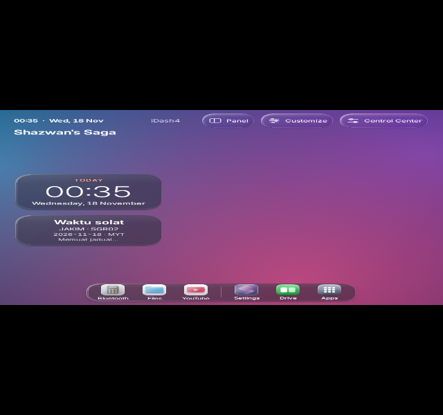
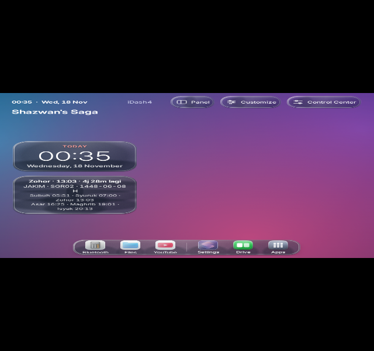

# iDash4 0.4.0-rc1 — integration and audit

Date: 18 November 2026. Branch: `integration/idash4-0.4.0-rc1`.

## What was combined

These are feature branches of one repository, not three independent apps:

| Input | Integrated content |
|---|---|
| fix/maps-panel-app-layout (`5ed2085`) | App Library 4×2, pagination/search, in-panel fullscreen custom video surface and explicit expansion. |
| feat/drive-templates-rc3 (`fca2930`) | Optional native Android Ringkas workspace, three root tabs, shortcuts, MediaSession controls and lifecycle cleanup. |
| feat/ios26-icons-rc4 (`00111f9`) | Pinned SysAdminDoc iOS26 icon assets, component/package/category mappings, icon-only rail, bounded bitmap cache and safe fallback. |

rc4 descends from rc3, which descends from rc2. An ancestry check confirmed every input tip is inherited by this integration; Git correctly reported already up to date. No duplicate feature copies or artificial conflict resolutions were introduced. Exact tips and conflict status are recorded in `audit-evidence/idash4-0.4.0-rc1/integrated-branches.json`.

The app is branded **iDash4**, version **0.4.0-rc1**, versionCode **6**. Application ID stays `com.shazwan.idash3`, preserving preferences, private wallpapers, selected apps, default-launcher component and update compatibility with the same signing key. No data reset/uninstall or merge to main is performed. Android service/notification/about labels are updated to iDash4 while component names and channel IDs remain compatible.

## Revised glass requirement and reversible materials

The owner explicitly allowed changing glass in the latest request, provided it can be reverted. Earlier rc1–rc4 reports that say glass was unchanged describe those historical candidates; this integration intentionally adds an optional material.

**Settings → Home & Dock → Liquid Glass → Material panel** offers:

- **iOS 26**: the default when no material preference exists. A cool frosted tint, cached diagonal gloss, cool lower shading and white inner rim adapt the icon pack's visual treatment to Android panels.
- **Classic iDash3**: the prior panel shader/material path, with no new gloss/shadow passes. It restores the material without changing saved tone, transparency, reflection, quality, animation or wallpaper settings.

Selection is saved separately in `glass_material_v4`. It is applied consistently through Home/dock/settings and Control Center factories, CapsuleSlider and the Appearance preview. Existing Solid/high-contrast panels remain Solid. The material setting is independent of the icon pack: Classic panels can still display iOS26 icons; the existing iOS icon switch controls app artwork.

The upstream pack contains raster artwork and a Python image-generation treatment, not a reusable Android panel renderer. This implementation references `_liquid_glass_transform` in `fetch_icons.py` at pinned upstream commit `db0ccf25ff695a076eee16833fd868a1a454cda6`: cool tint, diagonal gloss, lower cool shadow and white rim. It does not stretch an app icon over a panel or claim to run Apple's renderer. Existing cached frost is reused; no extra real-time blur, image decoder or unsupported GPU API is introduced for the panel material. New gradient objects are cached on material/bounds changes, not allocated per draw. Text-protection sampling accounts for the additional bright/dark passes.

Source/license/provenance for the 57 icon PNGs remains bundled. The upstream repository's MIT license and its separate artwork/trademark provenance note are preserved; iDash does not claim ownership of the artwork.

## Audit findings and corrections

| Finding | Correction | Evidence / limit |
|---|---|---|
| Unbounded bake backlog and work for obsolete geometry | One worker with at most 16 queued jobs. Obsolete requests are checked before pixel arrays are allocated. Callback validity is checked again before caching. Weak surface references avoid keeping discarded UI trees alive through callbacks. | Saturation test admits 16 requests, rejects 12 excess requests, and confirms stale requests produce no bitmap/cache entry. Real ARM32 timings remain unmeasured. |
| A second surface waiting for the same pending key could remain on fallback | Coalesced 120 ms retry invalidates geometry/cache lookup after pending work or admission pressure. | Successful caching/normal navigation is covered by UI and stability runs. This is not an assertion that every frame is fast. |
| Rejected/invalid requests could leave pending keys | Admission failure removes the key; completion removes accepted keys. | Queue test verifies pending state drains to zero. Actual bake allocation failures stay on the frost fallback instead of retrying OOM continuously. |
| Caches ignored memory-pressure callbacks | Icon and baked-glass caches evict references on memory trim; bitmaps are never recycled while views may still use them. | Cache budgets are not total memory caps: active views/catalogs can retain bitmap references. |
| Pack artwork could resurrect a shortcut for an uninstalled selected app | Resolve ActivityInfo and require enabled/exported activity before adding non-catalog shortcut artwork. | CrashSafetyChecks now tests a missing map component cannot appear in the shortcut snapshot. |
| Classic revert needed an independent reference | Capture 54 deterministic render profiles on the actual rc4 APK, then run the same probe against installed iDash4 and compare every pixel hash. | Baseline styles 0/1/2 × qualities 0/1/2 × tones 0/1/2 × customized false/true. These are sampled software-Canvas profiles, not a claim about all possible devices. |
| Material applied inconsistently to preview/controls | Explicit selection wiring at all context-aware GlassSurface construction sites. | Settings picker, persistence, retained Appearance values, factory modes and preview mode checked. |
| Branding and package migration could conflict | Update visible name/version only; keep package, classes, preference keys, data paths and signing continuity. | Installed package version is checked before counting the final test results. |

The refraction math in `GlassBake.bake` remains unchanged. Classic rendering remains identical for the captured profiles; queue admission/cancellation and cache policy improve independently of the selected visual material.

## Validation

Final result: 47 unit tests passed with zero failures/errors/skips; lint has zero errors. The integrated APK passed 541 functional assertions plus 54 Classic pixel profiles (595 checks across the completed runners). The new material passed 36 text-contrast fixtures with minimum observed ratio **6.17:1**; this is a fixture result, not a guarantee for all possible content. APK guard, signature and checksum passed.

Final build, test counts, raw completed runner results, Classic hashes and screenshots are under `audit-evidence/idash4-0.4.0-rc1/`. Only runs after the installed app reported `versionName=0.4.0-rc1` are counted for this candidate. Intermediate compile/runner attempts are not readiness evidence.

The Classic baseline was captured with the emulator still running rc4 (`versionCode=5`, `versionName=0.2.1-rc4`), before installing iDash4. The same probe compares the integrated candidate with that baseline. A separate test checks an individual drawable can switch Classic → iOS26 → Classic with identical restored pixels. UI tests preserve Appearance preferences and restore notification-listener access after using a real local MediaSession.

## Remaining limits and next checks

- Google Maps search freezing is still not reproduced/fixed inside Google's app. No third-party APK/version is silently replaced. Test standalone search, compatible Waze and the actual device's network/Google components.
- OEM radio, real video decoding/fullscreen callbacks, split-screen ROM behavior and Bluetooth/phone integration still require the head unit.
- Existing Auto-quality memory detection (`isLowRamDevice` or heap below 96 MiB) is retained. The unit's actual heap and OEM low-RAM flag are unknown; the prior audit's conditional boundary risk is not represented as solved.
- Normal Home/settings navigation still rebuilds view trees. Bounded bake work reduces waste but does not prove lag-free navigation. Performance Mode Low remains available; no automatic quality downgrade is forced by the new material setting.
- The icon cache is 1 MiB and the bake cache 6 MiB, plus live references and normal app memory. There is no claim that total PSS equals a Java heap limit or that the software emulator certifies Mali-450 performance.
- Tests use API27 x86_64 TCG/SwiftShader. A short stress run and weak-reference observations are not proof of zero long-term leaks.

Next physical QA: install over rc4 with the same key, confirm saved favorites/wallpaper remain, compare both material modes, run Maps/Waze search and video separately and together, then collect `dumpsys meminfo`, `gfxinfo ... framestats` and crash/ANR logs. Classic is the in-app revert path; downgrading/uninstalling is unnecessary merely to restore panel appearance.

### Material snapshots

Real emulator captures from the switch test; letterboxing belongs to the emulator display. Prayer data loads asynchronously, so these whole-screen snapshots can contain different prayer text/layout. The controlled 54-profile pixel comparison, rather than these screenshots, is the Classic equivalence evidence.

